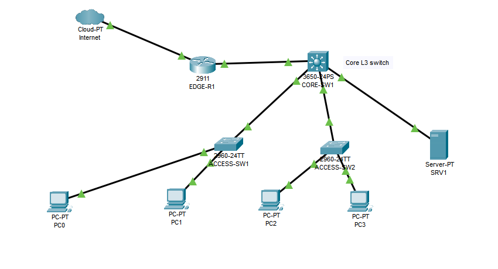

# Enterprise Network Lab — Cisco Packet Tracer

A campus-style enterprise networking lab for practicing and documenting VLAN segmentation, inter-VLAN routing, switching redundancy, DHCP, routing fundamentals, and network troubleshooting.

> **Environment:** Lab-only project using fictional, sanitized IP addressing. This is not production infrastructure.

## Topology



The conceptual topology includes an Internet connection, router, Layer 3 core switch, access switches, and end-user/server segments.

See the `topology/` directory for supporting topology documentation.

## VLAN and IP Addressing Plan

| VLAN | Name | Subnet | Default Gateway |
|---:|---|---|---|
| 10 | USERS | 192.168.10.0/24 | 192.168.10.1 |
| 20 | FINANCE | 192.168.20.0/24 | 192.168.20.1 |
| 30 | IT | 192.168.30.0/24 | 192.168.30.1 |
| 40 | SERVERS | 192.168.40.0/24 | 192.168.40.1 |
| 50 | VOICE | 192.168.50.0/24 | 192.168.50.1 |
| 99 | MANAGEMENT | 192.168.99.0/24 | 192.168.99.1 |

These are the documented design values. Validate the addressing and gateway configuration against the actual Packet Tracer lab as implementation progresses.

## Learning Scope

### Layer 2 Switching
- VLANs and access ports
- 802.1Q trunking and allowed VLANs
- Native VLAN considerations
- STP/RSTP and root bridge selection
- PortFast and BPDU Guard
- EtherChannel
- MAC address table verification

### Layer 3 Routing
- Switched Virtual Interfaces (SVIs)
- Inter-VLAN routing
- Static routes and default routes
- OSPF fundamentals
- Routing table verification

### Network Services
- DHCP and DHCP relay
- DNS concepts
- IP addressing and subnetting

### Security and Management
- Port security and ACL concepts
- Management VLAN
- SSH management access
- Network segmentation

## Troubleshooting Scenarios

Planned scenarios include:
- VLAN mismatch
- Incorrect trunk configuration
- Native VLAN mismatch
- VLAN missing from a trunk's allowed list
- Incorrect default gateway
- Missing route
- DHCP failure
- STP issue
- Duplicate IP address
- End-to-end connectivity failure

Document the symptoms, diagnostic commands, root cause, corrective action, and verification result for each scenario as it is implemented.

## Repository Structure

- `topology/` — topology documentation and design
- `documentation/` — VLAN and IP addressing documentation
- `configs/` — configuration examples as they are added
- `verification/` — test procedures and outputs as they are collected
- `enterprise-Topology.png` — topology diagram

## Verification Workflow

For each implemented lab:
1. Record the intended configuration.
2. Verify VLANs, access ports and trunks.
3. Check STP state and routing tables where applicable.
4. Test connectivity between intended endpoints.
5. Test DHCP and other services when configured.
6. Save sanitized command output or screenshots.
7. Record failures, root cause and resolution.

Example commands to use when relevant:

```text
show vlan brief
show interfaces trunk
show spanning-tree
show ip interface brief
show ip route
show running-config
ping <destination-ip>
```

Run commands only on devices and interfaces available in the actual lab. Add results only after performing the tests.

## Project Status

- [x] Topology and VLAN/IP design documented
- [ ] Switch and routing configurations implemented and documented
- [ ] Verification results collected
- [ ] Troubleshooting scenarios completed and documented

Update these items as the corresponding work is completed and verified.

## Tools

- Cisco Packet Tracer
- Cisco IOS CLI concepts
- Markdown documentation

## Future Improvements

- Complete and verify switching and routing configurations
- Add sanitized configuration examples
- Document troubleshooting exercises with evidence
- Add read-only Python network inventory and backup automation
- Expand into AWS cloud networking labs
